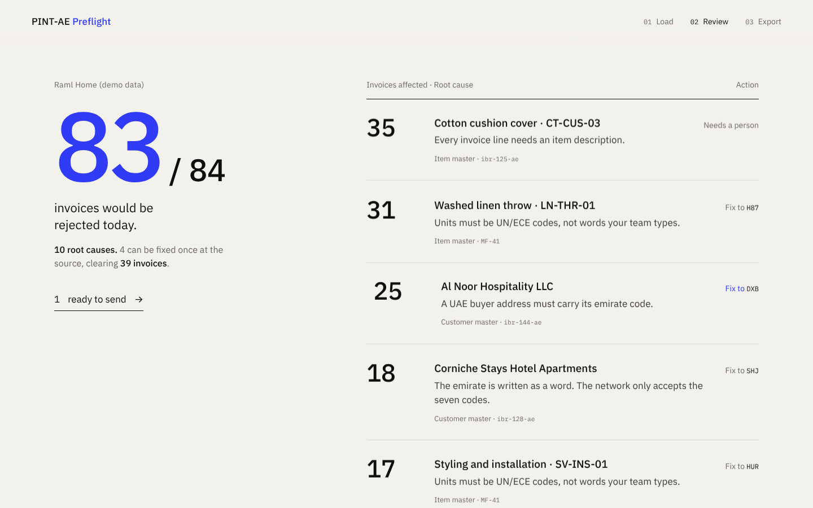

# PINT-AE Preflight

**Find the UAE e-invoices your ASP will reject, before you send them, and trace each one back to the single ERP record that causes it.**

From 1 January 2027, UAE businesses issue invoices as structured PINT AE XML through an Accredited Service Provider (ASP). The ASP validates every invoice and rejects the ones that break the rules. Most rejections do not come from the invoice itself. They come from master data: a customer address with no emirate code, an item whose unit is typed as "pcs", a mistyped TRN. One bad record breaks every invoice that uses it.

Preflight reads a normal ERP invoice export, runs the UAE rules, and groups every failure by **root cause**: the record to fix, where it lives in the ERP, and how many invoices it clears.



## What it does

1. **Load** an ERP export (CSV, one row per invoice line) or the built-in demo data for *Raml Home*, a fictional Dubai homeware retailer.
2. **Review** failures grouped by root cause, ranked by how many invoices each one blocks. Each cause shows the plain-language reason, the ERP area to fix it in (company setup, customer master, item master, tax setup, or the invoice itself), the official rule ID linked to the specification, and the exact XML line the ASP would receive.
3. **Approve fixes.** Where a fix is safe and certain (a city name to an emirate code, a free-text unit to its UN/ECE code), Preflight proposes it. Nothing changes until a person approves. Every approval is written to an audit log with a timestamp. Where a guess would be wrong, such as a mistyped tax number, it says so and leaves it to finance.
4. **Export** the invoices that now pass as PINT AE UBL 2.1 XML, plus the corrected CSV and the fix log.

On the demo data, 83 of 84 invoices fail. Ten root causes explain all of them, and four approved fixes clear 39 invoices in one pass.

## Rules covered

| Rule | Checks |
|---|---|
| MoF mandatory fields V1.0 | Presence of the header, party, and line fields from the Ministry of Finance list |
| `ibr-132-ae` | TRN is 15 digits, starts with 1, ends with 03 |
| `ibr-148-ae` | TIN is 10 digits, format 1XXXXXXXXX |
| `ibr-128-ae` | UAE country subdivision is one of AUH, DXB, SHJ, UAQ, FUJ, AJM, RAK |
| `ibr-143-ae` / `ibr-144-ae` | Seller and buyer address line, city, and subdivision present |
| `ibr-127-ae` | Payment due date present when an amount is due (credit notes and deemed supply excepted) |
| `ibr-154-ae` | Invoice transaction type code is exactly 8 flags of 0 and 1 |
| `ibr-147-ae` | Line net amount equals quantity × (net price ÷ base quantity) |
| `ibr-139-ae` / `ibr-145-ae` | Every line has a VAT category from S, E, O, AE, Z, N |
| `aligned-ibrp-s-05` / `ibr-120-ae` | Standard rated lines at 5%, zero rated lines at 0% |
| `ibr-125-ae` / `ibr-126-ae` | Item description, gross price, and price base quantity present |
| `ibr-104-ae` / `ibr-140-ae` | AED amounts on foreign currency lines, AED as VAT accounting currency |
| Unit of measure | Units are UN/ECE Recommendation 20 codes, with common free-text units mapped |

Preflight is a pre-submission check on ERP data. The ASP still runs the full PINT AE schematron, and that remains the final word.

## Run it

No dependencies. Node 18 or later.

```bash
npm test          # 16 rule tests
npm run build     # writes dist/index.html, one self-contained file
```

Open `dist/index.html` in a browser. Invoice data stays in the browser. Nothing is uploaded.

## Input format

One CSV row per invoice line. Header columns repeat on each line of the same invoice. Download the template from the app, or see `invoicesToCSV` in `src/data.js`.

## Structure

```
src/rules.js   validation rules, root-cause grouping, fix application
src/data.js    CSV parsing and the Raml Home demo dataset
src/ubl.js     PINT AE UBL 2.1 generation
src/app.js     interface
test/          node:test suite
```

## Sources

- UAE Ministry of Finance, *UAE Electronic Invoice Mandatory Fields*, V1.0, 23 February 2026
- Peppol, *PINT AE Billing* specification and AE rule set, v1.0.4, docs.peppol.eu/poac/ae

## Author

Lana Alzoubi · AI & Automation · [lanaalzoubi.com](https://lanaalzoubi.com)

MIT License.
