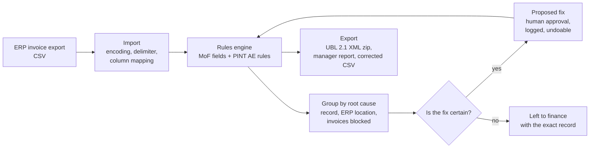

# PINT-AE Preflight

**Find the UAE e-invoices your ASP will reject, before you send them, and trace each one back to the single ERP record that causes it.**

[](https://lanaalzoubi521-lab.github.io/pint-ae-preflight/) [](https://github.com/lanaalzoubi521-lab/pint-ae-preflight/actions/workflows/test.yml)   

**[Open the live demo →](https://lanaalzoubi521-lab.github.io/pint-ae-preflight/)** Runs in the browser with sample data. Nothing to install, and invoice data never leaves the page.

UAE e-invoicing goes live in phases: from 1 January 2027 for businesses with revenue of AED 50 million or more, from 1 July 2027 for the rest. From then on, businesses issue invoices as structured PINT AE XML through an Accredited Service Provider (ASP). The ASP validates every invoice and rejects the ones that break the rules. Most rejections do not come from the invoice itself. They come from master data: a customer address with no emirate code, an item whose unit is typed as "pcs", a mistyped TRN. One bad record breaks every invoice that uses it.

Preflight reads a normal ERP invoice export, runs the UAE rules, and groups every failure by **root cause**: the record to fix, where it lives in the ERP, and how many invoices it clears.


## What it does

1. **Import** an ERP export as CSV. Built for real files: Excel exports in Windows-1256 (Arabic), semicolon or comma delimiters, thousands separators, Arabic digits. Column names differ per ERP, so Preflight guesses the mapping and asks only for what it cannot match. The mapping is remembered for that file layout.
2. **Company details once.** Seller fields are the same on every invoice, so they are entered once instead of exported on every row.
3. **Review** failures grouped by root cause, ranked by how many invoices each one blocks. Each cause shows the plain-language reason, where in the ERP to fix it, the official rule ID linked to the specification, and the exact XML line the ASP would receive.
4. **Approve fixes.** Where a fix is certain (a city name to an emirate code, a free-text unit to its UN/ECE code), Preflight proposes it. Nothing changes until a person approves, every approval is logged, and any approval can be undone. Where a guess would be wrong, such as a mistyped tax number, it is left to finance.
5. **Export** every ready invoice as PINT AE UBL 2.1 XML in one zip, a one-page readiness report for the finance manager, the corrected CSV, and the approval log.

On the demo data, 83 of 84 invoices fail. Ten root causes explain all of them, and four approved fixes clear 39 invoices in one pass.

## How it fits together



## Rules covered

| Rule | Checks |
|---|---|
| MoF mandatory fields V1.0 | Presence of the header, party, and line fields from the Ministry of Finance list |
| `ibr-132-ae` | TRN is 15 digits, starts with 1, ends with 03 |
| `ibr-148-ae` | TIN is 10 digits, format 1XXXXXXXXX |
| `ibr-128-ae` | UAE country subdivision is one of AUH, DXB, SHJ, UAQ, FUJ, AJM, RAK |
| MoF fields 17, 18, 26, 27 · `ibr-143-ae` / `ibr-144-ae` | Seller and buyer address line and city present; a UAE address carries its emirate |
| `ibr-127-ae` | Payment due date present when an amount is due (credit notes and deemed supply excepted) |
| `ibr-154-ae` | Invoice transaction type code is exactly 8 flags of 0 and 1 |
| `ibr-147-ae` | Line net amount equals quantity × (net price ÷ base quantity) |
| `ibr-139-ae` / `ibr-145-ae` | Every line has a VAT category from S, E, O, AE, Z, N |
| `aligned-ibrp-s-05` / `ibr-120-ae` | Standard rated lines at 5%, zero rated lines at 0% |
| `ibr-125-ae` / `ibr-126-ae` | Item description, gross price, and price base quantity present |
| `ibr-104-ae` / `ibr-140-ae` | AED amounts on foreign currency lines, AED as VAT accounting currency |
| Unit of measure | Units are UN/ECE Recommendation 20 codes, with common free-text units mapped |
| MoF field 1 | Invoice numbers are unique; two documents sharing a number are flagged, not merged |
| MoF fields 2, 6 | Dates are real dates in YYYY-MM-DD |
| MoF field 4 | Currency is a 3-letter ISO 4217 code |
| MoF field 22 | A UAE buyer's electronic address is their 10-digit TIN |
| MoF fields 20, 29 | Country codes are two capital letters; lowercase `ae` is flagged and still checked as the UAE |
| MoF fields 44, 45 | Gross price is not below net price; price base quantity is above zero |
| Numbers | Quantities, prices and amounts must be plain decimals (no hex, no `Infinity`); line arithmetic is decimal-safe |
| `ibr-055-ae` | A credit note references the invoice it corrects |

Preflight is a pre-submission check on ERP data. The ASP still runs the full PINT AE schematron, and that remains the final word.

**Current limits.** XML export covers AED invoices; foreign-currency invoices are checked but left out of the zip, because their AED line amounts and second tax total are not generated yet. Rules for special scenarios (free zone, deemed supply, margin scheme, disclosed agent, summary invoices) beyond the transaction-type format are not covered yet.

## Built with

Vanilla JavaScript (ES modules), no runtime dependencies · UBL 2.1 XML generation · `node:test` · GitHub Actions CI · Content Security Policy on the public build

## Run it

No dependencies. Node 18 or later.

```bash
npm test          # 41 tests: rules, import edge cases, security
npm run build     # writes dist/index.html, one self-contained file
```

Open `docs/index.html` in a browser (the public build, with a Content Security Policy that blocks all network access). Invoice data never leaves the browser. See [SECURITY.md](SECURITY.md).

## Input format

One CSV row per invoice line. Header columns repeat on each line of the same invoice. Download the template from the app, or see `invoicesToCSV` in `src/data.js`.

## Structure

```
src/rules.js   validation rules, root-cause grouping, fix application
src/data.js    CSV parsing and the Raml Home demo dataset
src/ubl.js     PINT AE UBL 2.1 generation
src/app.js     interface
test/          node:test suite
```

## Sources

- UAE Ministry of Finance, *UAE Electronic Invoice Mandatory Fields*, V1.0, 23 February 2026
- Peppol, *PINT AE Billing* specification and AE rule set, v1.0.4, docs.peppol.eu/poac/ae

## Author

Lana Alzoubi · AI & Automation · [lanaalzoubi.com](https://lanaalzoubi.com)

© 2026 Lana Alzoubi. All rights reserved. The code is published for review; reuse needs written permission. See [LICENSE](LICENSE). Demo data: Raml Home Trading LLC is a fictional company, and its TRNs are made up.
